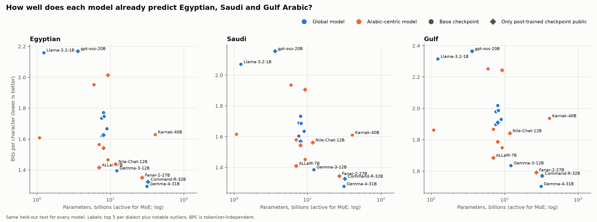

# Results: which model to start from for Egyptian, Saudi and Gulf Arabic

There are 21 models, all scored on the same held-out text. The full tables are in [`results/ranking.md`](results/ranking.md) and the per-set BPC in [`results/bpc_by_set.md`](results/bpc_by_set.md). Method: [README](README.md).

## Recommendation

| If you can train… | Egyptian | Saudi | Gulf / Emirati |
|---|---|---|---|
| **~30B** | **Gemma-4-31B** (base) | **Gemma-4-31B** (base) | **Gemma-4-31B** (base) |
| **~7–12B** | Gemma-3-12B (base), or ALLaM-7B for the cheapest tokens | Gemma-3-12B (base), or ALLaM-7B | Gemma-3-12B (base), or ALLaM-7B |
| **~1B** | Jais-3-0.9B | Jais-3-0.9B | Jais-3-0.9B |

- **Gemma-4-31B is first on all three dialects and on MSA.** Every other model is significantly worse; every 95% CI of the gap excludes 0. A base checkpoint is public, which is what continued pretraining needs. It also has the best Emirati multiple-choice score (Alyah 50.6%) and is within noise of the best on Belebele.
- **The next two are post-trained only.**
  - Command-R-32B is 2nd everywhere, but only its instruction-tuned checkpoint is public, and Cohere releases it for non-commercial use.
  - Fanar-2-27B is 3rd. It has the best Belebele scores for Egyptian (52.4%) and Najdi (49.9%), but that lead is within the ±3-point noise. It is also chat-only, and built on Gemma-3-27B.
- **Mid-size:**
  - **Gemma-3-12B** is the best *base* checkpoint below 30B in all three dialects.
  - **ALLaM-7B** is close behind (+0.02 to +0.05 BPC). Its tokenizer needs about **1.43 tokens per word against 1.88 for Gemma**, about 25% fewer tokens for the same text, so training and inference cost less. Only an instruction-tuned "preview" checkpoint is public.
  - **Fanar-1-9B** (base) is 6th–7th.

## Bits per character (lower is better)

| Model | Ckpt | Params (B) | Egyptian | Saudi | Gulf | MSA | Fertility (tok/word, Egyptian) |
|---|---|---|---|---|---|---|---|
| Gemma-4-31B | base | 31.3 | **1.294** | **1.277** | **1.502** | **1.136** | 1.88 |
| Command-R-32B | post | 32.3 | 1.323 | 1.326 | 1.569 | 1.154 | 2.05 |
| Fanar-2-27B | post | 27.0 | 1.350 | 1.343 | 1.591 | 1.185 | 1.88 |
| Gemma-3-12B | base | 12.2 | 1.396 | 1.386 | 1.635 | 1.213 | 1.88 |
| ALLaM-7B | post | 7.0 | 1.416 | 1.410 | 1.684 | 1.192 | 1.43 |
| Nile-Chat-12B | post | 11.8 | 1.438 | 1.562 | 1.841 | 1.348 | 1.88 |
| Fanar-1-9B | base | 9.2 | 1.466 | 1.452 | 1.749 | 1.199 | 2.00 |
| Command-R7B-Arabic | post | 8.0 | 1.542 | 1.544 | 1.787 | 1.343 | 2.05 |
| Jais-adapted-7B | base | 7.0 | 1.565 | 1.580 | 1.867 | 1.334 | 1.51 |
| Jais-3-0.9B | base | 1.1 | 1.608 | 1.616 | 1.861 | 1.393 | 1.71 |
| Falcon-H1-7B | base | 7.6 | 1.622 | 1.605 | 1.897 | 1.319 | 1.81 |
| Aya-Expanse-8B | post | 8.0 | 1.626 | 1.570 | 1.910 | 1.302 | 2.05 |
| Karnak-40B | base | 40.7 | 1.629 | 1.611 | 1.936 | 1.313 | 1.65 |
| Qwen3.5-9B | base | 9.0 | 1.668 | 1.636 | 1.930 | 1.327 | 1.86 |
| Qwen2.5-7B | base | 7.6 | 1.736 | 1.690 | 1.979 | 1.363 | 2.23 |
| Qwen3-8B | base | 8.2 | 1.747 | 1.687 | 1.987 | 1.345 | 2.23 |
| Llama-3.1-8B | base | 8.0 | 1.771 | 1.733 | 2.018 | 1.407 | 2.19 |
| Karnak-6B | base | 5.9 | 1.953 | 1.936 | 2.253 | 1.532 | 1.65 |
| Atlas-Chat-9B | post | 9.2 | 2.014 | 1.905 | 2.244 | 1.562 | 2.00 |
| Llama-3.2-1B | base | 1.2 | 2.160 | 2.070 | 2.315 | 1.677 | 2.19 |
| gpt-oss-20B | post | 20.9 (3.6 active) | 2.169 | 2.156 | 2.365 | 1.984 | 1.89 |

## Per dialect

**Egyptian**
- Order: Gemma-4-31B, then Command-R-32B (+0.030), Fanar-2-27B (+0.056) and Gemma-3-12B (+0.102).
- Nile-Chat-12B, the Egyptian-specific model, is 6th overall. It has the **smallest Egyptian-vs-MSA gap** on the same FLORES sentences: 1.085, against 1.19 for Gemma-4. Its knowledge is the most Egyptian-specific, but its MSA is weaker (1.348).

**Saudi**
- The ranking is the same as for MSA.
- The FLORES gap is about 1.02 for every model, so FLORES "Najdi" is almost MSA. The dialect signal comes from the FineWeb and speech sets (see `bpc_by_set.md`).

**Gulf / Emirati**
- Gemma-4-31B leads by the widest margin of any dialect: +0.067 over Command-R and +0.089 over Fanar-2.
- It has the best Alyah score: 50.6%, against 47.1% (Fanar-2) and 46.0% (ALLaM).
- This is the least-covered dialect. Gulf BPC is 0.15–0.25 higher than Egyptian for every model, partly because the Gulf text is all speech.

## Other findings
- **Size isn't everything.**
  - Karnak-40B ranks below Gemma-3-12B, ALLaM-7B and Fanar-1-9B.
  - The best Arabic-centric models at 7–12B (ALLaM-7B, Fanar-1-9B) beat the global models of the same size (Qwen, Llama, Falcon-H1) by 0.15–0.35 BPC on dialects.
- **Qwen3 is not better than Qwen2.5 on dialects,** and Qwen3.5 is only slightly better.
- **Weak options:** Karnak-6B, Atlas-Chat-9B (Moroccan-focused), Llama-3.2-1B and gpt-oss-20B are at the bottom for all three dialects.
- **The start token matters a lot,** so it was calibrated per model:

  | Start token | Models |
  |---|---|
  | Tokenizer default | Gemma, Fanar, Llama, Cohere, Jais-adapted, Atlas |
  | Newline | Qwen3, Qwen3.5, Karnak, ALLaM |
  | EOS | Qwen2.5, Falcon-H1, gpt-oss |
  | BOS | Jais-3, Nile-Chat |

## Caveats
- **Post-trained checkpoints** (`post`) are scored on raw text. Instruction tuning usually raises BPC somewhat, so their base models would probably rank a little higher.
- **Contamination:**
  - FLORES+ and Belebele are public and may be in some models' training data.
  - FineWeb-2 is a common pretraining source.
  - The speech transcripts (Omnilingual, Emirati shows, Alsanaa) are the least likely to have been seen.
- **Gulf data:**
  - It is small and speech only: 550K characters in total, and the Emirati TV/podcast set has 53 documents.
  - Alsanaa is a single radio book.
  - The Gulf ranking is clear, but the absolute numbers aren't comparable with Egyptian or Saudi.
- **Multiple choice is noisy:** the 95% CIs are about ±3 points. Use it as a sanity check, not to rank close models.
- **Not evaluated:** Llama-4-Scout, DeepSeek-V3 and Command-A (too large for the server's disk).
